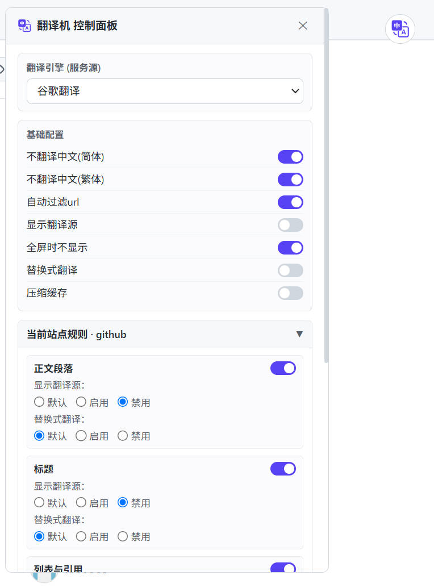

# 翻译机 V2
不是本人原创的，只是用AI修复了gtihub无法翻译加上美化了下界面，除了这句话其他都是AI干的活哈哈！

一款轻量、极简且强大的网页多语言翻译油猴脚本（Tampermonkey Userscript）。基于开源翻译引擎直接在浏览器本地运行，无需经过任何第三方中间服务器，保护隐私并提供极速翻译体验。

---

## 🌟 增加了什么

- **GitHub 搜索页支持**：新增对 `https://github.com/search` 搜索结果页的适配，自动翻译检索到的项目仓库介绍与摘要信息。
- **浮标快捷切换按钮（鼠标悬停触发）**：
  - **左侧状态开关（中 / 原）**：点击即可无感将当前页面实时还原为原始语言，再次点击即刻恢复中文翻译；全程优先复用已翻译缓存，避免重复调用接口消耗额度。
  - **下方模式切换（追 / 替）**：无需打开设置面板，点击即可在「纯中文替换翻译」与「双语对照追加」两种模式间即时无缝切换。
- **全新高质感矢量图标**：浮标采用现代化紫色多语言互译 SVG 矢量图标，清晰细腻。
- **控制面板 3 列网格排版**：规则列表采用 3 列流式紧凑网格布局，空间利用率大幅提升，界面清爽规整。
- **置顶悬停标题栏**：控制面板顶部增加专属标题与一键关闭（✕）按钮，滚动时始终固定于顶端。

---

## 🚀 改善了什么

- **GitHub 现代 DOM 与 Markdown 深度兼容**：
  - 全面适配 GitHub 最新页面架构，稳定翻译项目主页 README、分支文档以及任意 `*.md` 页面。
  - 智能匹配规则收敛：精准仅对 README、Markdown 文档及搜索页生效，避免非文档页面误触发。
- **排版结构与复杂表格无损渲染**：
  - 优化 DOM 节点解析机制，解决包含表格（Table）、列表（List）及元数据区块（YAML Frontmatter）时结构错位、单元格高度异常或嵌套表格消失的问题。
  - 替换翻译模式下完美保留原生排版与换行格式。
- **超链接智能回填与纯净显示**：
  - 修复替换模式下超链接标签退化为纯文本的缺陷，自动将原文超链接精确映射绑定至译文对应词汇。
- **简约扁平风控制面板**：
  - 采用 GitHub 风格的极简纯白卡片，去除刺眼的暗黑毛玻璃遮罩与厚重阴影，视觉体验轻快舒适。
  - 原生配置复选框升级为现代扁平滑动胶囊开关（Switch）。
  - 修复浮标就近弹出时的原生鼠标滚轮平滑滚动支持。
- **拖拽体验与鼠标手势冲突修复**：
  - 重构浮标拖拽机制，彻底杜绝 Chromium 扩展（如 crxMouse、SmartUp 等）误触发鼠标手势或超级拖拽的冲突问题。
  - 浮标默认初始位置优化，避免遮挡页面顶部核心导航按钮。

---

## 📥 安装与使用

1. 在浏览器中安装 [Tampermonkey（油猴）](https://www.tampermonkey.net/) 扩展。
2. 安装本脚本：将 `translator_fixed.user.js` 代码添加至 Tampermonkey 中并保存启用。
3. 打开任意支持的页面（如 GitHub 项目页或搜索页），页面右侧将出现紫色翻译浮标：
   - **单击浮标**：打开/关闭极简控制面板，自由切换翻译引擎与配置。
   - **悬停浮标**：呼出左侧「中/原」还原开关与下方「追/替」模式切换开关。
   - **拖动浮标**：按住主浮标可随意拖动至屏幕任意贴心位置。

---
